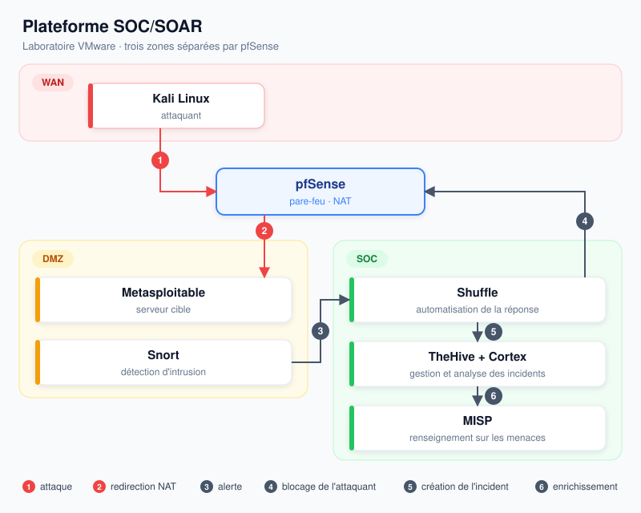

# PFA — Détection et réponse automatisée aux incidents de sécurité

Laboratoire SOC/SOAR entièrement open source, réalisé sous VMware.
Snort détecte les attaques, Shuffle bloque l'attaquant sur pfSense, et l'incident est traité dans TheHive, enrichi par Cortex et MISP.

Projet de fin d'année — IIT Sfax, Département Informatique, 2025/2026

## Architecture

## Fonctionnement

1. **Kali** lance une attaque (scan, brute force, injection SQL) contre l'adresse publique de **pfSense**.
2. **pfSense** redirige le trafic vers **Metasploitable**, le serveur cible de la DMZ.
3. **Snort** détecte l'attaque et envoie une alerte à **Shuffle**.
4. **Shuffle** bloque l'attaquant sur **pfSense**, en moins d'une minute.
5. **Shuffle** crée l'incident dans **TheHive**, où les analystes le traitent.
6. **Cortex** analyse l'IP de l'attaquant et interroge **MISP** pour reconnaître les attaquants déjà connus.

## Résultats

| Scénario | Résultat |
|---|---|
| Scan Nmap | détecté, attaquant bloqué en moins d'une minute |
| Brute force telnet | détecté et bloqué |
| Injection SQL | détectée et bloquée |
| Gestion d'incident | alerte créée automatiquement dans TheHive |
| Threat Intelligence | IP analysée par Cortex et reconnue par MISP |

## Outils

pfSense · Snort · Shuffle · TheHive · Cortex · MISP · PostgreSQL · Grafana · Docker · VMware

## Équipe

MAAZOUN Nour · CHOURA Yessine · TOUMI Karim · KALLEL Halim
